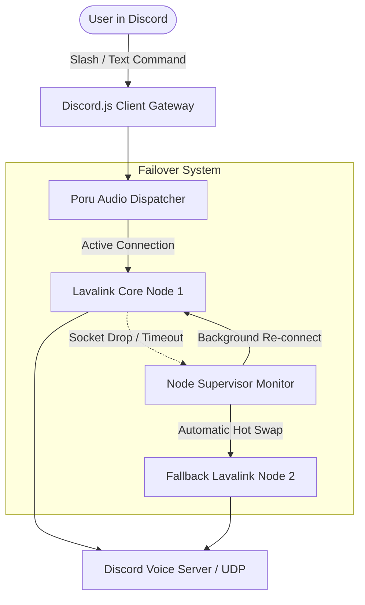

<div align="center">

```ascii
  ███████╗ █████╗ ███████╗██╗     ██╗███╗   ██╗ █████╗ 
  ██╔════╝██╔══██╗██╔════╝██║     ██║████╗  ██║██╔══██╗
  █████╗  ███████║█████╗  ██║     ██║██╔██╗ ██║███████║
  ██╔══╝  ██╔══██║██╔══╝  ██║     ██║██║╚██╗██║██╔══██║
  ██║     ██║  ██║███████╗███████╗██║██║ ╚████║██║  ██║
  ╚═╝     ╚═╝  ╚═╝╚══════╝╚══════╝╚═╝╚═╝  ╚═══╝╚═╝  ╚═╝
         🌸 A E S T H E T I C   M U S I C   B O T 🌸
```

# 🌸 FAELINA DISCORD MUSIC BOT
### *High-Performance, Standalone Discord Audio Bot Powered by Lavalink v4 & Poru*

[](https://nodejs.org/)
[](https://discord.js.org/)
[](https://github.com/parasop/poru)
[](https://github.com/sridharanry-star/lavalink)
[](LICENSE)

<br/>

<p align="center">
  <b>Faelina</b> is an ultra-sleek, feature-packed Discord music bot crafted with a beautiful <b>Neon Pink Sakura</b> aesthetic. Engineered for 24/7 reliability, zero downtime with multi-node Lavalink failover, responsive interactive button controls, and crystal-clear audio fidelity.
</p>

---

[✨ Features](#-key-features) •
[🚀 Quick Start](#-quick-start) •
[⚙️ Configuration](#️-configuration) •
[🎵 Commands](#-commands--controls) •
[🛡️ Architecture](#️-anti-crash--failover-architecture)

---

</div>

<br/>

## ✨ Key Features

- 🌸 **Sakura Blush Visuals**: Gorgeous custom player embed UI with rich metadata, duration bars, and high-res album covers.
- 🎛️ **Interactive Button Controls**: Real-time media controls (`Previous`, `Play/Pause`, `Stop`, `Skip`, `Loop`, `Shuffle`, `Bass Boost`, `Queue`).
- ⚡ **Multi-Node Failover**: Supports multi-node arrays with automatic dead-socket recovery, auto-healing, and seamless fallback.
- 🕒 **24/7 Voice Mode**: Keep the bot active in your voice channel permanently without timing out.
- 👑 **Owner Privilege System**: Configurable owner IDs with prefixless quick-command access (`p`, `s`, `dc`, etc.).
- 🛡️ **Anti-Crash Guard**: Bulletproof unhandled rejection and uncaught exception handlers keep the bot online continuously.
- 🌐 **Multi-Platform Audio**: Supports YouTube Music, Spotify, JioSaavn, SoundCloud, Deezer, and direct audio streams via Lavalink.

<br/>

---

## 🚀 Quick Start

### 1. Prerequisites
- **Node.js 18.0.0 or higher**: [Download Node.js](https://nodejs.org/)
- A **Discord Bot Token**: [Discord Developer Portal](https://discord.com/developers/applications)
- A running **Lavalink v4 Node**: [Ryuga Lavalink Server](https://github.com/sridharanry-star/lavalink)

### 2. Installation
Clone or extract the project:
```bash
git clone https://github.com/sridharanry-star/faelina-music-bot.git
cd faelina-music-bot
npm install
```

### 3. Configure `.env`
Copy the template and fill in your credentials:
```bash
cp .env.example .env
```
Open `.env` and set your `TOKEN` and Lavalink connection details.

### 4. Run the Bot
#### 🪟 Windows
Double-click `start.bat` or run:
```bat
start.bat
```

#### 🐧 Linux / macOS
```bash
chmod +x start.sh
./start.sh
```

#### ⌨️ Manual Command
```bash
npm start
```

<br/>

---

## ⚙️ Configuration (`.env`)

| Variable | Description | Default / Example |
| :--- | :--- | :--- |
| `TOKEN` | Discord Bot Application Token *(Required)* | `MTUxMzA...` |
| `OWNERS` | Comma-separated Discord User IDs for owner privileges | `1377967442172579843,1247200258719617115` |
| `SPOTIFY_CLIENT_ID` | Spotify API client ID *(Optional)* | `9f951e...` |
| `SPOTIFY_CLIENT_SECRET` | Spotify API client secret *(Optional)* | `e0c83c...` |
| `LAVALINK_HOST` | Primary Lavalink server host | `193.226.78.187` |
| `LAVALINK_PORT` | Lavalink server port | `4998` |
| `LAVALINK_PASSWORD` | Lavalink server password | `ryugalavalink` |
| `LAVALINK_SECURE` | Use SSL (`true` for https/wss, `false` for http/ws) | `false` |
| `LAVALINK_NODES` | JSON array of fallback nodes for automatic failover | `[{"name":"Node1", ...}]` |

<br/>

---

## 🎵 Commands & Controls

Default Prefix: `i` *(customizable via `i prefix <new_prefix>`)*

### 🎧 Music Playback
| Command | Aliases | Description |
| :--- | :--- | :--- |
| `play <query/url>` | `p` | Play a song or playlist from YouTube, Spotify, etc. |
| `pause` | - | Pause the current track |
| `resume` | `r` | Resume playback |
| `skip` | `s`, `next` | Skip to the next track in queue |
| `previous` | `prev`, `back` | Play the previous track |
| `stop` | `dc`, `leave` | Stop playback and disconnect from voice |
| `queue` | `q` | Display upcoming songs in queue |
| `clear` | `clr`, `clean` | Clear all tracks from queue |
| `shuffle` | `sh` | Shuffle songs in queue |
| `loop` | `repeat`, `lp` | Toggle track / queue loop mode |
| `bass` | `bb` | Toggle bass boost audio filter |

### ⚙️ Utilities & Admin
| Command | Description |
| :--- | :--- |
| `247` / `stay` | Toggle 24/7 stay mode in the current voice channel |
| `prefix <prefix>` | Change the server's command prefix |
| `status <text>` | Set bot custom status (Owner only) |
| `say <message>` | Send a message through the bot (Owner only) |

<br/>

---

## 🛡️ Anti-Crash & Failover Architecture



<br/>

---

## 📜 License
Distributed under the **MIT License**. Created with 💖 for high-performance Discord music streaming.
